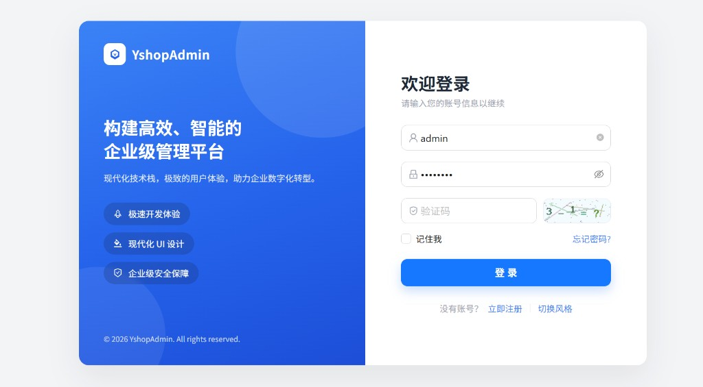
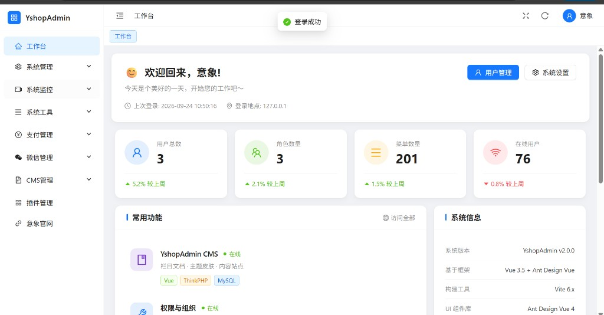
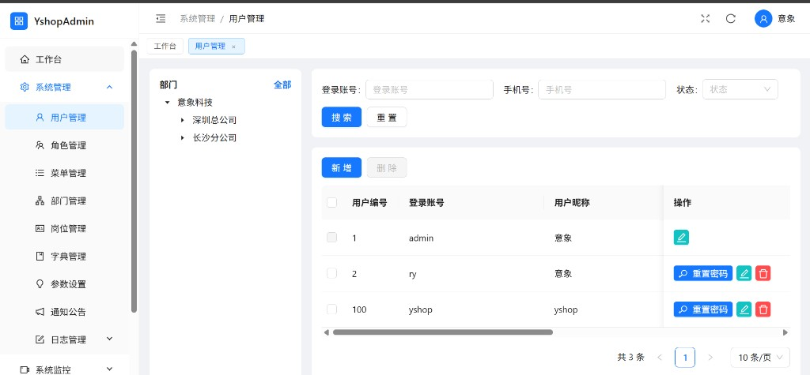
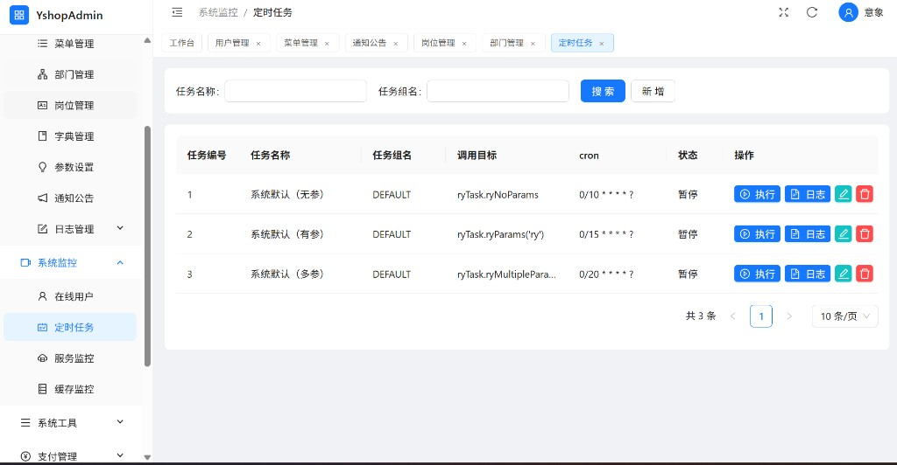
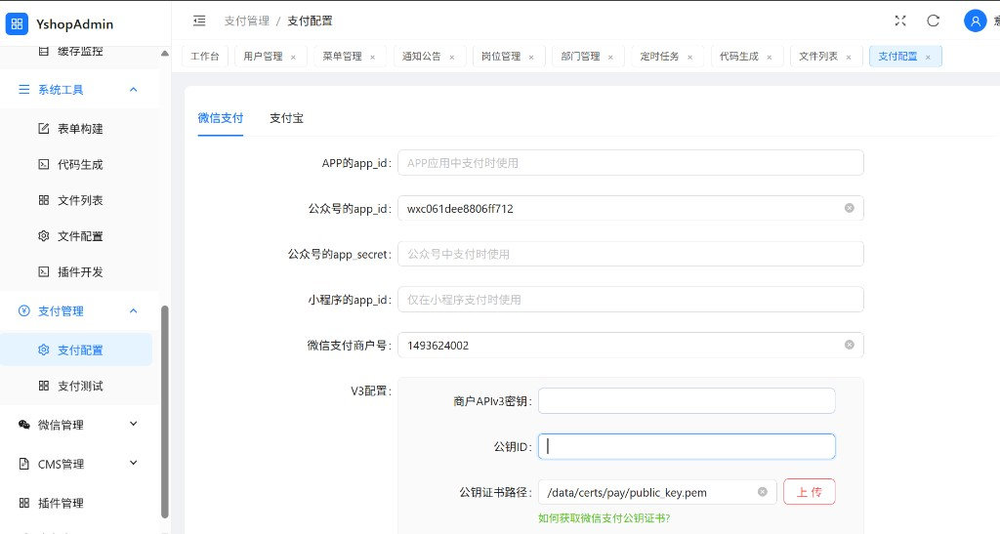
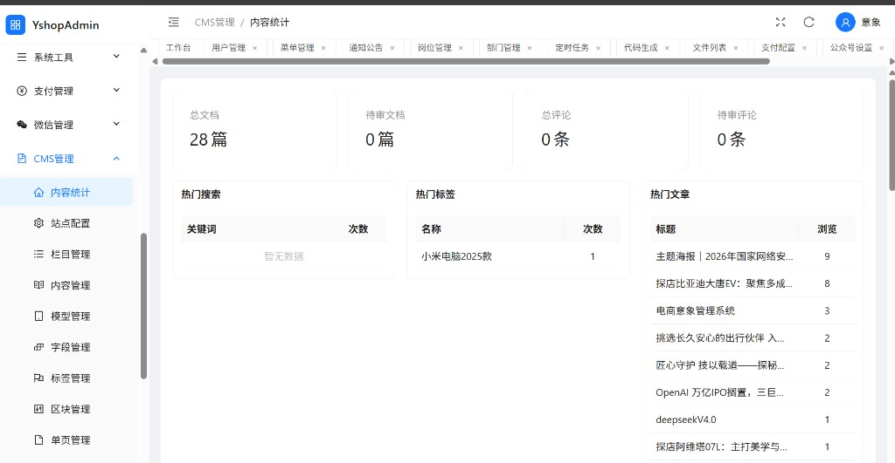
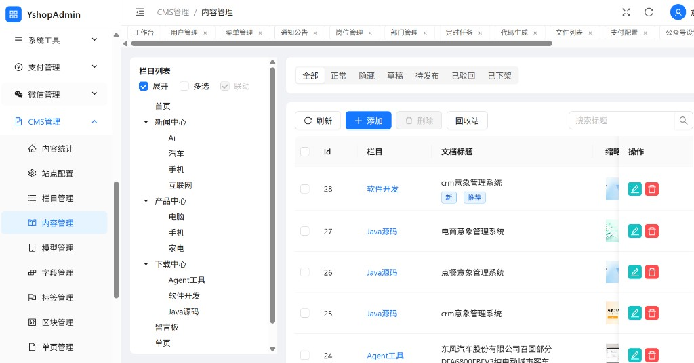

# YshopAdmin 快速开发平台

基于 **ThinkPHP 8 纯 API** + **Vue3 双 SPA** 的权限后台 / 内容站点平台

[](https://www.php.net/)
[](https://www.thinkphp.cn/)
[](https://www.mysql.com/)
[](./composer.json)

---

## 概述

- YshopAdmin：通用权限管理 + 站点内容（CMS 插件），开箱即用
- 管理端 `admin-ui/`（Vue3 + Ant Design Vue）；站点 `site-ui/`（Vue3 + Bootstrap 5）
- 后端 ThinkPHP 8 **JSON API**（`yshopadmin.php` / `index.php` 双网关）；无业务 SSR
- 默认 file 缓存 / Session，不强制 Redis

```
如果对你有帮助，欢迎 Star 收藏，谢谢！
```

## 快速开始

完整的环境要求、安装部署、账号说明与常见问题，请直接查看在线文档：

- 在线文档：https://cms.yixiang.co/yshopadmin/index.html


## 演示地址

- 在线演示：https://cms.yixiang.co/yshopadmin/index.html
`

### 演示效果















## 技术栈

### 后端

- 核心框架：ThinkPHP 8 + think-orm + vue3
- Excel：PhpSpreadsheet（导入 / 导出 / 模板）
- 鉴权：管理端 Bearer `adm_` / 会员 Bearer `mem_`；`AdminToken` / `MemberToken` / `Permission` / `OperLog`
- 权限模型：RBAC（菜单权限标识）+ 数据范围
- 分页约定：`PageHelper`；JSON 信封 `code: 200`
- 缓存 / Session：默认 **file**（可选 Redis，非必须）
- 定时任务：`php think job:run` + 任务白名单

### 前端

- 管理端：`admin-ui/` — Vue3 + Vite + Ant Design Vue + Pinia（部署 `public/admin/`）
- 站点端：`site-ui/` — Vue3 + Vite + Bootstrap 5 + bootstrap-vue-next（部署 `public/site/`）
- CMS 插件后台页与站点主题：`addons/yscms/web/{admin,site}/`

## 内置功能

1. **用户管理**：系统操作者配置，支持导入导出与重置密码
2. **部门管理**：组织机构树（公司 / 部门 / 小组）
3. **岗位管理**：用户职务配置
4. **菜单管理**：目录 / 菜单 / 按钮权限标识（SPA path/component）
5. **角色管理**：菜单权限与数据范围分配
6. **字典管理**：系统固定数据项维护
7. **参数设置**：系统动态参数配置
8. **通知公告**：公告信息发布与维护
9. **操作日志** / **登录日志** / **在线用户**
10. **定时任务** / **服务监控** / **缓存监控**
11. **代码生成**：导入数据表，预览 / 下载 PHP CRUD 骨架
12. **文件管理**（系统工具）：本地 / S3 等存储
13. **插件开发**（系统工具）：CMS 向脚手架 / 打包 / 菜单同步
14. **支付** / **微信**：系统一级菜单（配置、回调、验证码等）
15. **插件管理**：安装 / 启停 / 配置（目标态主要管理 yscms）
16. **CMS（yscms 插件）**：栏目 / 文档 / 主题皮肤 / 内容 API

## 项目结构

```text
YshopAdmin/
├── admin-ui/                # 管理端 SPA（Ant Design Vue）
├── site-ui/                 # 站点 SPA（Bootstrap 5）
├── addons/
│   └── yscms/               # 唯一业务插件（CMS）
├── app/
│   ├── controller/api/      # JSON API（system / monitor / tool / pay / wechat）
│   ├── service/             # 业务逻辑（含 pay / wechat / file / addondev）
│   ├── library/             # 内置底层库
│   ├── common/              # Auth、BuiltinConfig、PageHelper、Token…
│   ├── middleware/          # AdminToken、MemberToken、JsonOnly…
│   └── …
├── config/builtin/          # 支付/微信配置 schema
├── data/builtin/            # 内置配置值；data/certs/pay/ 证书
├── database/sql/
├── public/                  # Web 根（yshopadmin.php / index.php / site / admin）
├── route/app.php
└── README.md
```

新增系统能力：`app/controller/api` + `app/service` + `admin-ui` + `route/app.php`。内容类插件才写 `addons/{name}/`。

## 优势

1. 权限、数据范围、操作日志开箱即用，业务只需补 CRUD / API
2. 前后端分离，管理端与站点双 UI 库隔离
3. 代码生成 + 插件脚手架（CMS 向）减少重复劳动
4. 依赖少（PHP + MySQL 即可），上手与部署成本低
5. 结构清晰：内置能力与内容插件边界明确

## 特别鸣谢
- [ruoyi](https://github.com/yangzongzhuan/RuoYi) — 若依系统
- [ThinkPHP](https://www.thinkphp.cn/) — PHP 应用框架
- [PhpSpreadsheet](https://github.com/PHPOffice/PhpSpreadsheet) — Excel 读写
